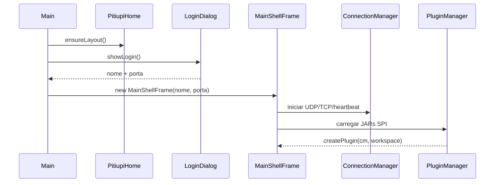
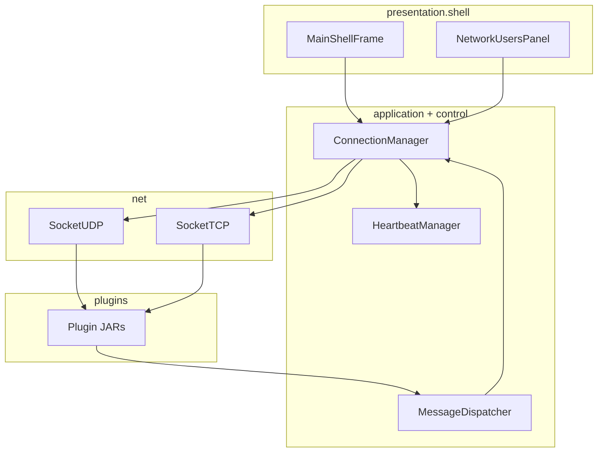

# Visão geral

O `Pitiupi` é uma plataforma P2P baseada em uma arquitetura de plugins, 
desenvolvida para permitir a criação de aplicações distribuídas sobre uma 
infraestrutura comum de comunicação em rede.

A aplicação fornece mecanismos de descoberta de usuários, comunicação entre 
peers, troca de mensagens serializadas e integração de extensões por meio de 
plugins. A comunicação de rede utiliza dois protocolos de transporte: UDP, 
empregado principalmente na descoberta e comunicação multicast entre as 
instâncias, e TCP, utilizado para comunicação direta e persistente entre peers.

O projeto serve como base para experimentação de aplicações distribuídas e 
desenvolvimento de extensões via plugins.

Índice: [README.md](README.md).

# Arquitetura geral

A aplicação é dividida em três grupos principais:

- **Núcleo da aplicação**: a `MainShellFrame` coordena GUI, rede e plugins.
- **Sistema de plugins**: extensões em JAR carregadas de `PITIUPI_HOME/plugins` (dev: `./scripts/pitiupi.sh link --all`).
- **Comunicação de rede**: UDP (`SocketUDP`) e TCP (`SocketTCP`, `TcpConnection`).

## Inicialização da aplicação

1. `Main` garante o layout em `PITIUPI_HOME` e abre o `LoginDialog` (nome e porta, PT-BR, ~30% da área útil do monitor, centralizado).
2. Após confirmar o login, a `MainShellFrame` é exibida (1024×768, centralizada).
3. O `SocketUDP` associa-se à porta configurada e ingressa no grupo multicast.
4. O `SocketTCP` cria um `ServerSocket` na mesma porta para conexões TCP.
5. Os mecanismos de comunicação iniciam threads de recepção.
6. O `HeartbeatManager` envia heartbeats periodicamente; o `NetworkUsersPanel` lista peers via `PresenceService`.
7. O `PluginManager` carrega os JARs em `plugins/` via SPI, com `ShellPluginWorkspace` ligado às abas centrais.

Ver também: [05_udp_multicast.md](05_udp_multicast.md), [09_sistema_de_plugins.md](09_sistema_de_plugins.md).

### Teste manual T-LOGIN-01 (login centralizado)

1. Compilar e executar: `./scripts/pitiupi.sh run --all` na raiz do repositório.
2. O `LoginDialog` deve aparecer **no centro** do monitor principal (WSL/KDE), não no canto superior esquerdo.
3. Após entrar, a `MainShellFrame` (1024×768) também deve abrir centralizada.

A posição exata depende do gerenciador de janelas; o núcleo recentra após exibir a janela.

### Atualizar plugin Chat (Onda E)

O JAR do módulo é `plugins/chat/dist/pitiupi.chat.jar` (catálogo `plugins.registry.json`). Não use `dist/chat.jar`.

```bash
cd plugins/chat && ant clean jar
./scripts/pitiupi.sh link --all
```

Isso recria o symlink `~/pitiupi/plugins/chat.jar` → o JAR buildado. O comando `link` lista o destino real de cada `.jar`.

# Interface gráfica

A interface gráfica é Swing, organizada em shell (`pitiupi.presentation.shell`):

| Região | Componente |
|--------|------------|
| Centro | `TabWorkspacePanel` — aba **Plugins** (galeria; abre plugin sob demanda), abas de plugin **fecháveis** (×), aba **Configurações** |
| Leste | `NetworkUsersPanel` — “Usuários nesta rede”, peer actions (badges na lista: **D23**, adiados — ver [decision-register.md](../decision-register.md)) |
| Sul | Barra de status (porta e nome local) |
| Menu | `ShellMenuBar` — apenas **Ajuda → Sobre** (sair pelo X da janela) |

Plugins expõem `getName()` (técnico), `getIdentifier()` (SPI) e `getDisplayName()` (texto na galeria e nas abas).

A aba **Configurações** mostra em cima **Sua conexão** (nome, porta, IP local, ID da instância, contagem de peers; campos selecionáveis para copiar manualmente) e embaixo a tabela de JARs instalados (altura reduzida).

Durante a inicialização, cada plugin recebe `ConnectionManager` e `PluginWorkspace`
no método `createPlugin()`. Menus multicast na barra superior não são mais usados;
ações para todos os peers migram para **peer actions** (contexto na lista lateral).
Ao iniciar, só as abas **Plugins** e **Configurações** ficam visíveis. Cada plugin registra um painel com `bindShellWorkspaceContent`; a aba abre ao clicar na galeria ou via peer action. Referência: **Conversa na rede** (`ChatPanel`) e **Compartilhar tela** (`ScreenCastPanel`).

O **chat** usa campo de mensagem compacto (~2 linhas, quebra de linha; barra de rolagem vertical só se o texto não couber). O histórico ocupa a maior parte da altura da aba (divisor proporcional ao abrir a janela).

Canal TCP privado do chat fica no mesmo `ChatPanel` (histórico separado por conversa: sala geral, peer por IP, privado com toggle). O núcleo mantém `PeerActivityInbox` para atividade por peer; indicadores visuais completos na lista lateral ainda não fazem parte da v1 (**D23**).

Ao fechar a aba superior de **Compartilhar tela** (×), o núcleo chama `Plugin.onShellTabClosed()` — o plugin interrompe captura e envio (toggle desligado). Reabrir pela galeria deve mostrar compartilhamento inativo.

**TCP (transporte)** envia uma mensagem serializada pelo núcleo (`sendTcp`), na porta do login. **TCP privado** (toggle) abre conexão dedicada ao plugin entre dois peers; com o toggle ativo, o combo de transporte fica desabilitado e o envio usa esse canal. Na UI só se informa o **IP** do peer: UDP/TCP unicast do Pitiupi usa sempre a **mesma porta** que você escolheu no login (convenção de sala: todos com a mesma porta, ex. 5000 e 5001 em testes no mesmo PC).

Textos da UI (destino, combo de forma de envio e linha **“Como esta mensagem vai”**) usam linguagem simples e o termo técnico entre parênteses (multicast UDP, UDP unicast, TCP). Na sala, o transporte não é só multicast: o combo pode escolher cópias unicast ou TCP para cada pessoa, conforme o plugin.

Ver [12_menus_unicast_multicast.md](12_menus_unicast_multicast.md).

## Boot (sequência)



## Camadas de comunicação



O UDP multicast sustenta presença e mensagens broadcast/unicast; o TCP sustenta
canais diretos com framing de mensagens. Detalhes em [05](05_udp_multicast.md)
e [06](06_tcp_conexoes.md).

### Exemplo: um envio UDP até outro peer

1. Plugin chama `MessageDispatcher` (ou `ConnectionManager`) com `TransportMode` e destino.
2. Mensagem serializada (`Message.toByteArray()`).
3. `SocketUDP` monta `DatagramPacket` (multicast `224.0.0.3` ou unicast ao IP do peer).
4. Peer receptor: thread de `SocketUDP.receive()` desserializa e `PluginManager` entrega ao plugin que declarou o tipo em `getMessages()`.

Ver [07_mensagens_e_serializacao.md](07_mensagens_e_serializacao.md).
