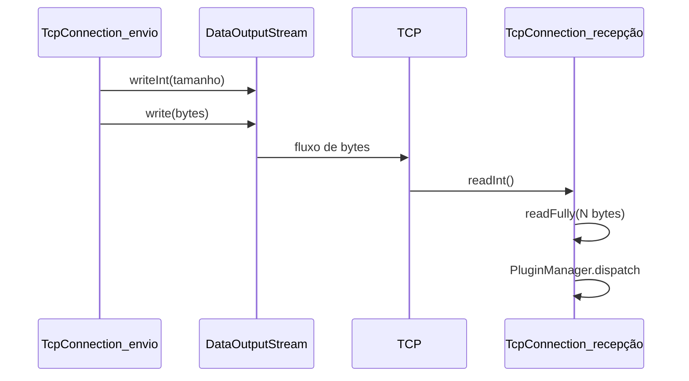

# Comunicação TCP

**Teoria:** TCP oferece fluxo confiável e ordenado entre dois sockets; a aplicação ainda precisa definir **limites de mensagem**. **No Pitiupi:** framing `int` tamanho + bytes serializados. **Limitação:** uma conexão por endereço IP de peer no mapa gerenciado por `TcpConnectionManager`.

A comunicação TCP é implementada principalmente por `SocketTCP`, com o mapa de conexões em `TcpConnectionManager`.

Diferentemente do UDP, o TCP estabelece conexões entre dois peers. Essas conexões 
são mantidas enquanto forem necessárias e podem ser reutilizadas para o envio de 
múltiplas mensagens.

A arquitetura utiliza uma conexão TCP persistente por endereço de peer.

O `TcpConnectionManager` mantém um mapa `InetAddress` → `TcpConnection`, permitindo reutilizar a mesma conexão para vários envios ao mesmo peer.

### SocketTCP

A classe `SocketTCP` estende `Thread` e implementa `PeerListener`.

Ao ser criada, ela inicializa um `ServerSocket` utilizando a porta configurada na 
aplicação.

O servidor TCP permanece aguardando novas conexões enquanto a aplicação estiver 
em execução.

### Envio de mensagens TCP

O método `send()` recebe uma mensagem serializada e o endereço IP do peer destinatário.

Antes de enviar a mensagem, o `SocketTCP` verifica se já existe uma conexão válida com 
o peer.

O comportamento é:

1. Procurar uma conexão existente no mapa de conexões.
2. Verificar se a conexão está fechada.
3. Caso não exista uma conexão válida, criar um novo Socket TCP para o endereço do peer.
4. Encapsular o socket em uma `TcpConnection`.
5. Registrar a conexão no mapa.
6. Iniciar uma tarefa de recepção para essa conexão.
7. Enviar a mensagem pela conexão.

Assim, uma conexão TCP existente pode ser reutilizada para várias mensagens, evitando
a criação de um novo socket para cada envio.

### Recepção de conexões

O método `receive()` permanece aguardando novas conexões através de 
`ServerSocket.accept()`.

Quando uma conexão é aceita:

O endereço IP do peer é obtido.
Um objeto `TcpConnection` é criado para encapsular o socket.
A conexão é registrada no mapa de conexões.
Caso já exista uma conexão associada ao mesmo endereço, a conexão anterior é encerrada.
Uma tarefa independente de recepção é criada para a nova conexão.

Esse modelo permite que o servidor aceite múltiplas conexões sem bloquear o 
processamento das conexões já existentes.

### Recepção concorrente

A recepção das mensagens TCP é realizada de maneira concorrente por meio de um
`ExecutorService`.

Cada conexão possui uma tarefa própria responsável por receber continuamente as 
mensagens.

O fluxo de recepção é:

```
SocketTCP
|
+-- Peer A → TcpConnection → tarefa de recepção
|
+-- Peer B → TcpConnection → tarefa de recepção
|
+-- Peer C → TcpConnection → tarefa de recepção
```

Dessa forma, uma conexão bloqueada ou aguardando dados não impede que outras conexões
continuem sendo processadas.

Quando uma mensagem é recebida por uma `TcpConnection`, ela é encaminhada ao `PluginManager`, que despacha para os plugins cujo `getMessages()` inclui o tipo.

O plugin identifica o tipo em `receiveMessage()` e processa na thread adequada (UI via `SwingUtilities.invokeLater` quando necessário).

### TcpConnection

A classe TcpConnection encapsula uma conexão TCP individual entre dois peers.

Ela mantém:

o Socket utilizado na conexão;
um DataInputStream para recepção;
um DataOutputStream para envio.

Além de encapsular esses recursos, a classe é responsável pelo framing das mensagens.

### Framing das mensagens TCP

A classe `TcpConnection` encapsula uma conexão TCP individual entre dois peers.

Ela mantém:

1. o `Socket` utilizado na conexão;
2. um `DataInputStream` para recepção;
3. um `DataOutputStream` para envio.

Além de encapsular esses recursos, a classe é responsável pelo framing das mensagens.

Framing das mensagens TCP

O protocolo TCP fornece um fluxo contínuo de bytes e não preserva os limites das 
mensagens enviadas pela aplicação.

Por esse motivo, é adicionado o tamanho da mensagem antes do conteúdo.

O formato utilizado é:

```
+----------------------+----------------------+
| tamanho da mensagem | dados da mensagem    |
+----------------------+----------------------+
4 bytes              N bytes
```

O tamanho é enviado como um `int`, seguido pelos bytes da mensagem.

No envio, o método `TcpConnection.send()`:

1. obtém o tamanho do vetor de bytes;
2. escreve o tamanho no `DataOutputStream`;
3. escreve os dados da mensagem;
4. realiza `flush()` no stream.

O acesso ao stream de saída é sincronizado para evitar que envios concorrentes 
misturem seus dados.

Na recepção, o método `receive()`:

1. lê o tamanho da mensagem;
2. verifica se o tamanho é válido;
3. lê a quantidade correspondente de bytes;
4. retorna o vetor de bytes completo.

Esse mecanismo permite que várias mensagens sejam transmitidas pela mesma conexão
TCP sem que o receptor perca a delimitação entre elas.

### Integração entre TCP e gerenciamento de peers

O `SocketTCP` implementa a interface PeerListener para acompanhar as alterações na 
lista de peers ativos.

O `HeartbeatManager` mantém a lista de peers atualmente detectados na rede. Quando 
essa lista é alterada, o SocketTCP recebe a notificação por meio do método
`onPeersChanged()`.

O método obtém os endereços IP dos peers atualmente ativos e compara esses endereços
com as conexões TCP existentes.

Quando uma conexão pertence a um peer que não está mais ativo:

a conexão é removida do mapa;
a conexão TCP é encerrada;
os recursos associados são liberados.

Esse mecanismo impede que conexões TCP permaneçam abertas indefinidamente para peers
que já deixaram de participar da rede.

O fluxo de integração pode ser representado da seguinte forma:
```
HeartbeatManager
|
| peers ativos alterados
|
v
SocketTCP.onPeersChanged()
|
| compara peers ativos
|
v
+---- peer ativo ------> mantém conexão
|
+---- peer inativo ----> fecha conexão
```



Quando usar TCP no Pitiupi: chat e screencast oferecem TCP na UI; presença continua em UDP. Compare com [05_udp_multicast.md](05_udp_multicast.md) e [16_fundamentacao_redes.md](16_fundamentacao_redes.md).
