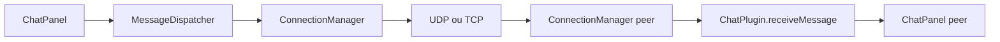

# Plugins de referência

Dois módulos buildáveis no catálogo; o chat unifica o antigo mpChat (multicast, unicast, TCP e canal TCP privado).

## Comparativo

| | plugins/chat | plugins/screencast |
| --- | --- | --- |
| Build | Ant | Ant |
| id | `chat` | `screencast` |
| Classe | `ChatPlugin` | `ScreenCastPlugin` |
| Mensagem | `ChatMessage`, `LegacyMpChatMessage` | `ScreenCastMessage` |
| UI | `ChatPanel` (destino + transporte) | `ScreenCastPanel` (destino + transporte) |
| TCP privado | Toggle no `ChatPanel` + hooks `receiveBytes` (histórico `private:<IP>`) | — |

## plugins/chat

Fluxo resumido:

1. `ChatPlugin.createPlugin` registra `ChatPanel` e peer actions (sala, peer, TCP privado).
2. Envio: usuário escolhe destino e `TransportMode` → `MessageDispatcher` → UDP ou TCP do núcleo.
3. Recepção: `ChatMessage` em `receiveMessage` → histórico na aba correta (sala, IP ou canal privado).
4. TCP privado: toggle desliga o combo de transporte e usa bytes dedicados ao plugin.

Código de entrada: `plugins/chat/src/pitiupi/chat/plugin/ChatPlugin.java`.

## plugins/screencast

Fluxo resumido:

1. Captura de tela em loop (com throttling) → `ScreenCastMessage` com imagem serializada.
2. Destino geral: multicast; um peer: unicast/TCP conforme painel.
3. `SessionNoticeMessage` (núcleo) marca início/fim de sessão para fechar abas de recepção.

Código de entrada: `plugins/screencast/src/pitiupi/screenCast/plugin/ScreenCastPlugin.java`.

**Limitação:** largura de banda e MTU — frames grandes podem sofrer perda em UDP; adequado para demonstração, não para produção.

## Exercício Ping

Material em [17_tutorial_ping_aula.md](17_tutorial_ping_aula.md) e pasta `plugins/ping/` (sem código/JAR no repositório). Não entra no `plugins.registry.json` nem no gate CI.

## Limitações didáticas (não são bugs)

Os plugins de referência são **exemplos de sala de aula**, não produtos completos:

| Plugin | Inclui | Não inclui (de propósito) |
| --- | --- | --- |
| **chat** | texto, sala geral, unicast/multicast/TCP, TCP privado básico | imagens, moderação, histórico persistente, criptografia |
| **screencast** | stream read-only, avisos de sessão | controle remoto do mouse/teclado, áudio |
| **ping** (exercício do aluno) | chrome de sessão v1 (`PluginRoutingPanel`, abas ↑/↓), RTT, UDP apenas | TCP privado, ICMP do SO, gráficos, SLA |

Para evoluir: copie o padrão (`Plugin` + mensagens + painel na aba) e acrescente features no **seu** JAR — sem inflar o núcleo.
