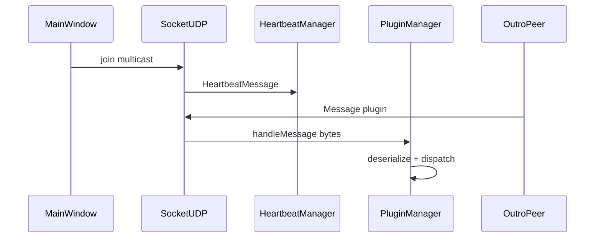

# Plugins de referência

Três exemplos no repositório para comparar estilos de integração. Todos devem ser empacotados em `pitiupi/plugins/`.

## Comparativo

| | pitiupi.chat | pitiupi.screenCast | pitiupi.mpChat |
| --- | --- | --- | --- |
| Build | Ant | Ant | Make |
| id (`plugins.registry.json`) | `chat` | `screencast` | `mpchat` |
| Classe | `ChatPlugin` | `ScreenCastPlugin` | `MultiProtocolChat` |
| Categoria menu | `Social` | `Streaming` | `Social` (multicast + unicast) |
| Mensagem | `ChatMessage` | `ScreenCastMessage` | `MpChatMessage` |
| Transporte principal | UDP (via `ConnectionManager`) | UDP / payloads maiores | UDP público + **TCP privado** |
| TCP avançado | Não | Depende da versão do módulo | `receivePrivateConnection`, `receiveBytes` |

## pitiupi.chat

- **Referência canônica** alinhada ao contrato atual `Plugin` + `ConnectionManager` / `GuiManager`.
- `createPlugin` registra `ChatMenu` em `MenuCategory.Social`.
- `getMessages()` retorna `ChatMessage.class`; `receiveMessage` atualiza `ChatWindow`.

Caminhos: `pitiupi.chat/src/pitiupi/chat/plugin/ChatPlugin.java`.

## pitiupi.screenCast

- Demonstra compartilhamento de tela / imagens (`ScreenCastWindow`, `ScreenCastMessage`).
- Útil para discutir **tamanho de datagramas**, compressão (`ImageTransformation`) e limites UDP.

Caminhos: `pitiupi.screenCast/src/pitiupi/screenCast/`. Alinhado ao contrato `Plugin` + `ConnectionManager` / `GuiManager` (como `ChatPlugin`).

## pitiupi.mpChat

- Chat **público** (multicast / unicast UDP) e **privado** (TCP).
- `createPlugin(ConnectionManager, GuiManager)` como nos demais plugins; usa `ConnectionManager.connectPluginTcp` para abrir canal privado.
- Sobrescreve hooks TCP do `Plugin` (`receivePrivateConnection`, `receiveBytes`, `onSocketClosed`).

Caminhos: `pitiupi.mpChat/src/plugin/MultiProtocolChat.java`.

## Fluxo UDP (todos os plugins)

Heartbeat não passa pelos plugins — ver [08_heartbeat_e_presenca.md](08_heartbeat_e_presenca.md).

## Próximo passo

Criar plugin próprio: [10_tutorial_plugin.md](10_tutorial_plugin.md).
