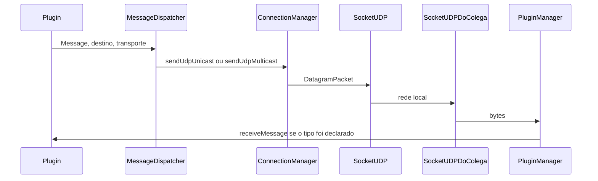

# Rede no Pitiupi

Dois processos só se veem se estiverem na mesma sub-rede, na mesma porta e se o multicast da rede local não for filtrado. O Pitiupi não usa ICMP: o “ping” da disciplina é um plugin de mensagens Java, descrito à parte. Também não há criptografia.

A mesma porta do login serve para UDP e para TCP. Trocar a porta na aba **Configurações** envia um goodbye na sala antiga, fecha as conexões TCP locais e passa a anunciar na porta nova. Se a porta nova não abre, a sala anterior volta.

## UDP

UDP manda um datagrama e não abre conexão. Não há garantia de entrega nem de ordem. Multicast entrega uma cópia do pacote a quem entrou no mesmo grupo.

No Pitiupi, `SocketUDP` cria um `MulticastSocket` na porta do login, entra no grupo **`224.0.0.3`** e fica numa thread recebendo datagramas. Os buffers têm 256000 bytes. O TTL padrão é **1** (só a rede local). Na aba Configurações ele vai de 1 a 32.

Há dois destinos, no mesmo socket:

- **Multicast** (`sendMulticast`): o pacote vai para `224.0.0.3`. Quem está no grupo e na mesma porta recebe.
- **Unicast** (`sendUnicast`): o pacote vai para o IPv4 de uma pessoa, na mesma porta.

Um plugin não abre esse socket. Ele pede o envio a `MessageDispatcher`, que chama `ConnectionManager.sendUdpMulticast` ou `sendUdpUnicast`. O desenho está em [nucleo-para-plugins.md](nucleo-para-plugins.md).

Na chegada, `SocketUDP` tenta ler o datagrama como `HeartbeatMessage`. Se for heartbeat, entrega ao `HeartbeatManager`. Se não for, os bytes vão ao `PluginManager`, que tenta desserializar com as classes que cada plugin declarou.

## Presença

Ver alguém na lista **Usuários nesta rede** significa que um heartbeat UDP recente chegou. Isso não abre TCP.

A cada cerca de 5 segundos o núcleo manda, em multicast, uma `HeartbeatMessage` com o nome, um id da instância e o instante. Quem recebe atualiza o peer pelo id da instância. Se o nome mudar, a lista do colega mostra o nome novo no anúncio seguinte.

Quem fica cerca de **15 segundos** sem heartbeat sai da lista. Ao fechar a janela, o núcleo manda `GoodbyeMessage` em multicast. `SocketTCP` escuta essa lista e fecha a conexão TCP de quem saiu.

Heartbeat e goodbye são do núcleo. O plugin não declara esses tipos em `getMessages()`.

## TCP

TCP é um fluxo de bytes entre dois sockets, com entrega ordenada. O fluxo não marca onde uma mensagem acaba e a outra começa. Por isso cada envio no Pitiupi é:

```
4 bytes (int, tamanho N) + N bytes da mensagem serializada
```

`TcpConnection.send` escreve o tamanho e os bytes e dá `flush`. `receive` lê o inteiro e depois exatamente N bytes. O acesso à saída é sincronizado para dois envios não se misturarem.

`SocketTCP` abre um `ServerSocket` na mesma porta do login. Existe uma conexão pública reaproveitada por endereço IP: se já houver socket aberto para aquele IP, o próximo envio usa o mesmo. Ao aceitar uma conexão nova do mesmo IP, a anterior é fechada.

Abrir TCP pode demorar. `ConnectionFactory` usa `Socket.connect` com prazo de **5 segundos**. O chat dispara isso fora da thread da janela e só mostra “Conectando em …” enquanto ainda não há socket para aquele IP. O prazo não aparece na tela. O tempo de leitura depois do handshake continua longo.

Há também conexão TCP dirigida a um plugin (`receivePrivateConnection`, `receiveBytes`, `onSocketClosed`). O chat usa isso para o texto privado. O identificador do plugin (`getIdentifier()`) diz a quem a conexão pertence.

## Mensagens

`pitiupi.models.Messages.Message` implementa `Serializable`. `toByteArray()` vira o `byte[]` que UDP e TCP carregam. O transporte não olha os campos: quem entende o conteúdo é o plugin que declarou a classe.

Na recepção, `PluginManager` percorre os JARs. Para cada um, `PluginObjectInputStream` desserializa com o classloader daquele JAR. Se a classe estiver em `getMessages()` (ou se `receiveAllTypes()` for verdadeiro e a mensagem for pública), o núcleo chama `receiveMessage`. Tipo desconhecido é ignorado.

Os dois lados precisam da mesma versão das classes. JARs diferentes geram falha de desserialização, não uma mensagem “quase certa”.

## Qual transporte usar

| Necessidade | Transporte no Pitiupi |
| --- | --- |
| Avisar a sala inteira de uma vez | UDP multicast |
| Falar com um IP sem conexão | UDP unicast |
| Fluxo confiável e ordenado com um IP | TCP |
| Saber quem está online | Heartbeat UDP (núcleo) |

Imagem grande em UDP pode passar do tamanho do datagrama e se perder. O screencast oferece TCP por isso. O ping de referência mede RTT com UDP unicast.

## Interface, TTL e WSL

A aba **Configurações** lista só as interfaces que **este** processo enxerga. Nome `eth`, `eno`, `enp`, `ens` ou “Ethernet” é cabo. Nome `wlan`, `wlp` ou “Wi-Fi” é Wi-Fi.

A saída pode ser Automático (cabo antes de Wi-Fi), só Cabo ou só Wi-Fi. Multicast, o IP exibido e o TCP de saída usam essa interface. No Automático, cabo com endereço `169.254.*` tem prioridade. `169.254.x` e `192.168.x` em máquinas diferentes não compartilham heartbeat.

| Processo | O que aparece |
| --- | --- |
| `java.exe` do Windows | Placas reais |
| Ubuntu instalado no PC | `wlan*` e `eth*` / `enp*` reais |
| `java` de dentro do WSL | Em geral `eth0` ou `eth1`, classificado como cabo. Não há `wlan` |

Dois arranjos de WSL, e nenhum substitui o Java do Windows na sala:

- **NAT** (IP `172.x`): o Linux não está na rede dos colegas. Aumentar o TTL não coloca esse processo na LAN.
- **Rede espelhada** (o `eth*` mostra o mesmo IPv4 do Windows): o rótulo continua cabo por causa do nome Linux. O socket ainda é o da interface virtual.

Na sala, os dois lados usam o mesmo tipo de processo: os dois no Java do Windows, ou os dois no Ubuntu instalado na máquina. O script do WSL (`./scripts/pitiupi.sh run --all`) abre a janela no Java do Windows de propósito. O passo a passo de cada máquina está em [comecar.md](comecar.md).

No Windows, o campo de IP do peer usa `PeerIpv4`: IPv4 pontilhado, sem forma `::ffff:` e sem sufixo de zona (`%7`).

## Dois computadores

1. A mesma porta no login (por exemplo `5000`).
2. IPs na mesma sub-rede (`192.168.0.x` com `192.168.0.y`, ou os dois em `169.254.x`).
3. Firewall liberando UDP e TCP nessa porta.
4. No roteador, sem isolamento de clientes, sem Wi-Fi de visitantes que bloqueie multicast.
5. Esperar até cerca de 15 segundos (o anúncio sai a cada 5).

Se o `tracert` até o colega tiver um salto só, TTL 1 basta. Se houver mais roteadores no meio, suba o TTL até o número de saltos, no máximo 32, nos dois lados. Um roteador só encaminha o grupo multicast se estiver configurado para isso.

Como ler ping do sistema, `netstat` e lista vazia: [usar.md](usar.md).


